# 🐾 Pokemon Service

A **Spring Boot 3** application providing a REST API to retrieve Pokemon data integrated with the
external [PokéAPI](https://pokeapi.co/) and manage a collection of favorite Pokemon persisted in **MongoDB**.

## 🛠 Tech Stack

* **Java 21**
* **Spring Boot 3.x**
    * Spring Web (`RestClient`)
    * Spring Data MongoDB
    * Spring Validation
* **MongoDB** (Database)
* **Lombok**
* **JUnit 5 & MockMvc & MockRestServiceServer** (Testing)
* **Flapdoodle Embedded MongoDB** (Integration Tests)

## 📐 Class Diagram

Below is the class diagram showing relationships between controllers, services, repositories, DTOs, MongoDB entities,
and PokéAPI response objects:

```mermaid
classDiagram
%% Controller Layer
    class PokemonController {
        -PokemonService service
        +getAllPokemon() List~AllPokemonEntity~
        +getPokemonByName(name: String) PokemonResponse
        +getRandomPokemon() PokemonResponse
        +compare2Pokemon(name1: String, name2: String) ComparisonDTO
        +getPokemonByType(type: String) List~AllPokemonEntity~
    }

    class FavoriteController {
        -FavoriteService service
        +getAllFavorites() List~Favorite~
        +getFavoriteById(id: String) Favorite
        +addFavorite(favoriteDTO: FavoriteDTO) Favorite
        +updateFavorite(id: String, updateFavoriteDTO: UpdateFavoriteDTO) Favorite
        +deleteFavoriteById(id: String) void
        +searchFavorites(name: String, nickname: String) List~Favorite~
    }

%% Service Layer
    class PokemonService {
        -RestClient restClient
        +getAllPokemon() List~AllPokemonEntity~
        +getPokemonByName(name: String) PokemonResponse
        +getRandomPokemon() PokemonResponse
        +compare2Pokemon(name1: String, name2: String) ComparisonDTO
        +getPokemonByType(type: String) List~AllPokemonEntity~
    }

    class FavoriteService {
        -FavoriteRepo favoriteRepo
        -PokemonService pokemonService
        +getAllFavorites() List~Favorite~
        +getFavoriteById(id: String) Favorite
        +addFavorite(favoriteDTO: FavoriteDTO) Favorite
        +updateFavorite(id: String, updateFavoriteDTO: UpdateFavoriteDTO) Favorite
        +deleteFavoriteById(id: String) void
        +searchFavorites(name: String, nickname: String) List~Favorite~
    }

%% Repository Layer
    class FavoriteRepo {
        <<interface>>
        +existsByName(name: String) boolean
        +existsById(id: String) boolean
        +getFavoriteByName(name: String) Favorite
        +searchByNicknameContainsIgnoreCase(nickname: String) List~Favorite~
        +searchByNameContainsIgnoreCase(name: String) List~Favorite~
        +searchByNameContainsAndNicknameContainsIgnoreCase(name: String, nickname: String) List~Favorite~
    }

%% Domain / Model
    class Favorite {
        <<record>>
        +String id
        +String name
        +String nickname
        +Integer pokemonId
        +Integer base_experience
        +Integer height
        +Integer weight
        +List~Type~ types
    }

    class Type {
        <<record>>
        +String name
        +String url
    }

%% DTOs
    class FavoriteDTO {
        <<record>>
        +String name
        +String nickname
    }

    class UpdateFavoriteDTO {
        <<record>>
        +String nickname
    }

    class ComparisonDTO {
        <<record>>
        +String heavierPokemon
        +Integer weightDifference
        +String higherPokemon
        +Integer heightDifference
    }

%% PokéAPI Response Records
    class PokemonResponse {
        <<record>>
        +Integer id
        +String name
        +Integer base_experience
        +Integer height
        +Integer weight
        +List~Types~ types
    }

    class Types {
        <<record>>
        +Integer slot
        +Type type
    }

    class AllPokemonResponse {
        <<record>>
        +Integer count
        +List~AllPokemonEntity~ results
    }

    class AllPokemonEntity {
        <<record>>
        +String name
        +String url
    }

    class TypeResponse {
        <<record>>
        +Integer id
        +String name
        +List~TypePokemonListResponse~ pokemon
    }

    class TypePokemonListResponse {
        <<record>>
        +Integer slot
        +AllPokemonEntity pokemon
    }

%% Relationships
    PokemonController --> PokemonService
    FavoriteController --> FavoriteService
    FavoriteService --> FavoriteRepo
    FavoriteService --> PokemonService
    Favorite "1" *-- "many" Type
    PokemonResponse "1" *-- "many" Types
    Types "1" *-- "1" Type
    AllPokemonResponse "1" *-- "many" AllPokemonEntity
    TypeResponse "1" *-- "many" TypePokemonListResponse
    TypePokemonListResponse "1" *-- "1" AllPokemonEntity
    FavoriteService ..> FavoriteDTO
    FavoriteService ..> UpdateFavoriteDTO
    PokemonService ..> ComparisonDTO
```



## 🚀 Key Features & Endpoints

### 1. PokéAPI Integration (`/api/pokemon`)

* **`GET /api/pokemon`** — Fetch a list of all available Pokemon.
* **`GET /api/pokemon/name/{name}`** — Retrieve details for a specific Pokemon by name.
* **`GET /api/pokemon/random`** — Retrieve details for a random Pokemon.
* **`GET /api/pokemon/compare/{name1}/{name2}`** — Compare two Pokemon by height and weight.
* **`GET /api/pokemon/type/{type}`** — List Pokemon filtered by type (e.g., `fire`, `water`, `grass`).

### 2. Favorite Collection Management (`/api/collection`)

* **`GET /api/collection`** — Retrieve all saved favorites from MongoDB.
* **`GET /api/collection/{id}`** — Fetch a specific saved favorite by ID.
* **`POST /api/collection`** — Add a Pokemon to favorites (fetches metadata automatically from PokéAPI).
    * *Request Body:* `{"name": "pikachu", "nickname": "Sparky"}`
* **`PUT /api/collection/{id}`** — Update the custom nickname of a saved favorite.
    * *Request Body:* `{"nickname": "Flash"}`
* **`DELETE /api/collection/{id}`** — Remove a Pokemon from favorites.
* **`GET /api/collection/search?name={name}&nickname={nickname}`** — Search saved favorites by name and/or nickname.

## ⚙️ Setup and Run

### Prerequisites

* **Java 21**
* **MongoDB** (running locally or a MongoDB Atlas connection string)

### Environment Variables

The Mongo URI is configured via an environment variable.

In `application.properties`:

```properties
spring.mongodb.uri=${MONGO_DB_URI}
```

Set the environment variable before starting the application:

```bash
export MONGO_DB_URI="mongodb+srv://<user>:<password>@<cluster>/<db_name>"
```

### Build & Run

```bash
# Run unit & integration tests
./mvnw test

# Start application
./mvnw spring-boot:run
```

## 🧪 Testing

The repository contains test coverage via unit and integration tests (`PokemonServiceTest`, `FavoriteServiceTest`,
`PokemonControllerTest`, `FavoriteControllerTest`), verifying REST controllers, service layer logic, exception handling,
and input validations using MockRestServiceServer and Embedded MongoDB.